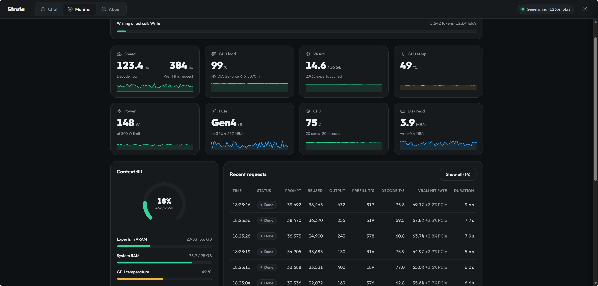
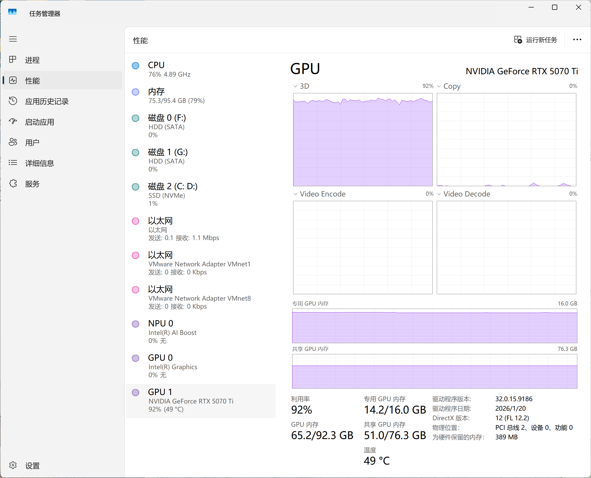
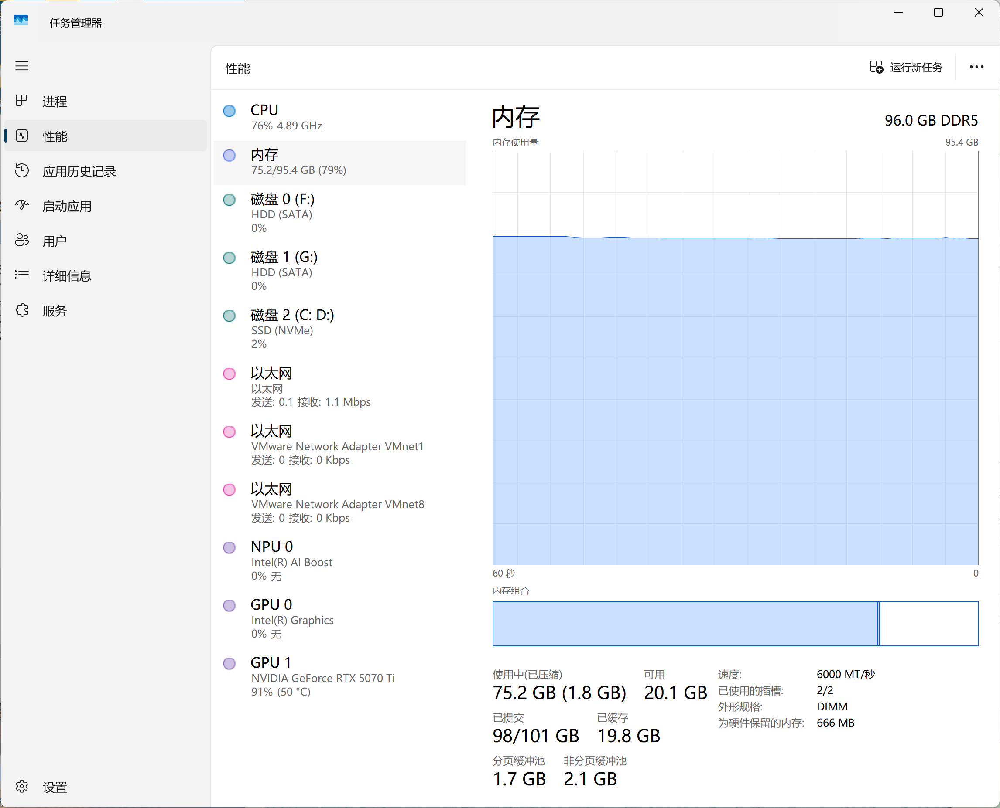
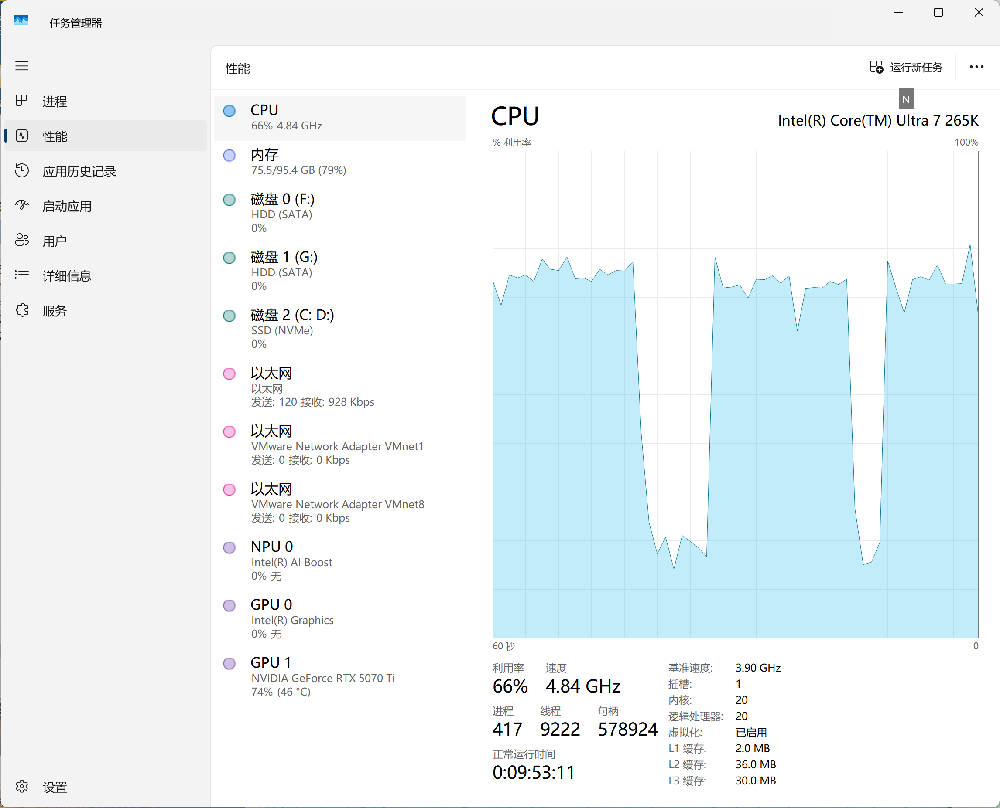
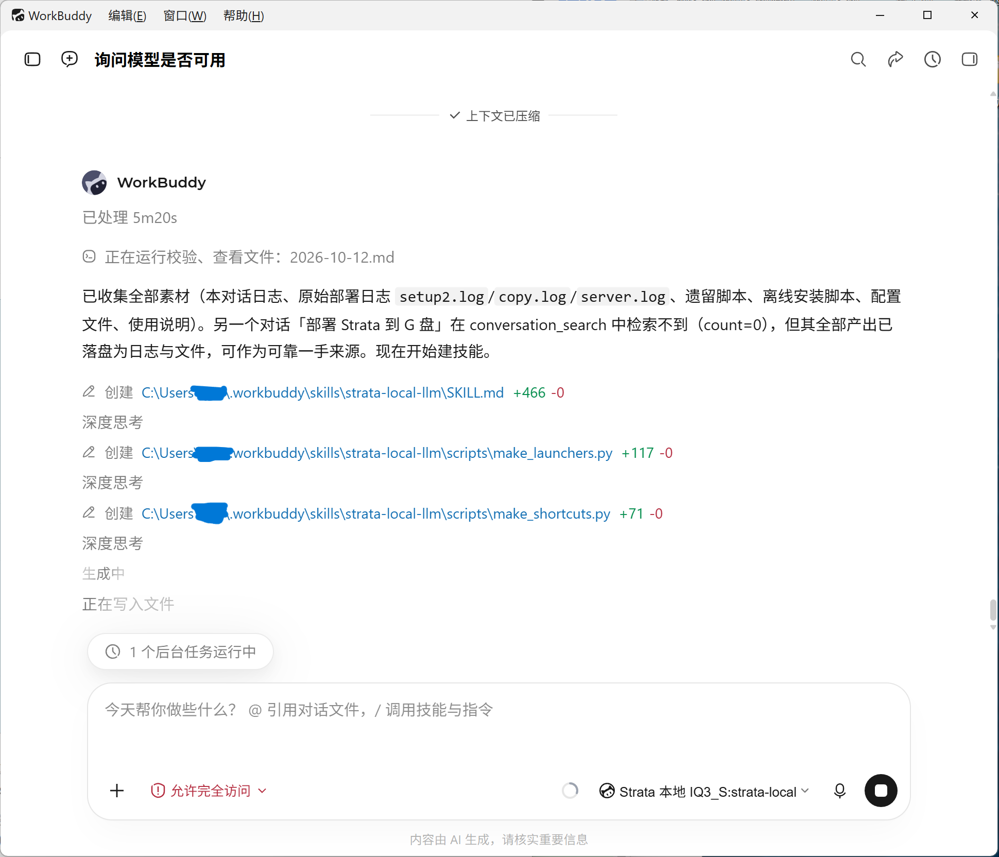

# Strata 本地大模型 · Windows 实战笔记与辅助脚本

> **辅助性第三方安装笔记，不是官方项目。**
> 引擎与模型都有官方页面和官方一键安装，**安装请优先走官方流程**：
>
> | 官方资源 | 链接 |
> | --- | --- |
> | Strata 引擎（官方仓库，MIT） | <https://github.com/Niko1221/Strata> |
> | 模型官方页（Qwen3.8-Flash-Next） | <https://huggingface.co/Qwen/Qwen3.8-Flash-Next> |
> | IQ3_S 量化版（ISTA-DASLab） | <https://huggingface.co/ISTA-DASLab/Qwen3.8-Flash-Next-GSQ-RCO-GGUF> |
> | 官方安装指南（人类版） | <https://github.com/Niko1221/Strata/blob/main/docs/INSTALL.md> |
> | 官方安装指南（给 AI agent 版） | <https://github.com/Niko1221/Strata/blob/main/docs/AI_SETUP.md> |
>
> 官方 Windows 安装就是双击 `START-HERE.bat`，自动检测硬件、选规格、下载、启动。
> **官方一键装成功的话，你不需要本仓库。**

> 🖥️ **本介绍页由该本地模型生成**——即下文实测的那台机器上跑的 Qwen3.8-Flash-Next IQ3_S，
> 全程离线、未调用任何云端 API。文中表格与结论由模型整理，数字均取自本机实测截图，已人工核对。

<!-- 上游实时数据（徽章由访问者浏览器加载，无需手填数字；如需纯文本数字可跑 scripts/fetch_upstream_stats.py） -->

---

## 一、结论先行：一次真实部署后的评价

我们在一台**普通游戏 PC**（非服务器、非工作站）上完整跑通了 Strata + Qwen3.8-Flash-Next **IQ3_S**
（125B 参数、3.5-bit 量化、84 GB 权重），并把它接进 AI agent 作为日常推理后端连续使用。

**评价：这个项目解决的是"消费级硬件跑超大 MoE 模型"的真问题，工程完成度明显高于同类方案。**

值得称道的几点（均为实测确认，非宣传语）：

1. **专家驻内存 + GPU 缓存的路线是对的。** 46.84 GiB 专家权重放系统内存，GPU 只缓存约 2,900 个专家（5.6 GB）。
   16 GB 显存的消费卡因此能跑 125B 模型——这是 llama.cpp 常规 offload 路线做不到的。
2. **自带可观测性，调优不靠猜。** 引擎内置 Monitor 页，实时显示 decode/prefill 速度、VRAM、
   expert cache 命中率、PCIe 通道与带宽、功耗、上下文占用。本仓库的性能结论全部来自这个面板。
3. **prompt 复用做得很实。** Monitor 的 `reused` 列显示 39,692 token 的 prompt 里复用了 38,665——
   agent 反复追加对话时几乎不重读历史，这是 agent 场景下速度能撑住的关键。
4. **安装体验对新手友好。** 硬件自检会主动指出问题（本机就被指出"显卡只跑在 x8 而非 x16"），
   下载可断点续传，`--calibrate` 会按本机实测核数分配 worker。
5. **文档密度高。** `docs/` 下 30+ 篇专题文档（KV 预取、多卡、显存弹性、批处理、故障排查），
   且明确写出各方案在不同显卡上的实测数字，不画饼。

需要预期的两点（不是缺点，是物理规律）：

- **单请求速度有天花板。** 见下文第五节，16 GB 级卡跑 IQ3_S 单请求达不到 200 tok/s。
- **首次加载会让机器卡 1–3 分钟**（要把 46 GB 读进内存并锁给 GPU），属正常。

---

## 二、实测截图（2026-10-12，本机连续运行中）

### 1. 引擎自带 Monitor：真实吞吐与缓存状态

同一时刻的关键读数：

| 指标 | 读数 | 说明 |
| --- | --- | --- |
| Decode 速度 | **123.4 tok/s** | 当前请求的生成速度（峰值） |
| Prefill 速度 | **384 tok/s** | 本次请求读取 prompt 的速度 |
| GPU 负载 | 99% | RTX 5070 Ti 基本打满 |
| VRAM | **14.6 / 16 GB** | 2,933 experts cached |
| GPU 温度 / 功耗 | 49 °C / **148 W**（限 300 W） | 远未触发热墙，安静 |
| PCIe | **Gen4 x8**，到 GPU 4,257 MB/s | 引擎直接指出通道数（官方自检也提示应为 x16） |
| 系统内存 | 75.7 / 95 GB | 专家权重驻内存 |
| 磁盘读 | 3.9 MB/s | **权重已全在内存/固态热态，几乎不读盘** |
| 上下文占用 | 18%（46K / 256K） | 256K 上限已生效 |

下方 `Recent requests` 表六条真实请求（agent 连续调用）：

| prompt | reused | output | prefill t/s | decode t/s | VRAM 命中率 |
| ---: | ---: | ---: | ---: | ---: | ---: |
| 39,692 | **38,665** | 432 | 317 | **75.8** | 69.1% (+2.2% PCIe) |
| 38,470 | 36,370 | 255 | 519 | 69.5 | 67.8% (+2.3%) |
| 36,375 | 34,900 | 243 | 378 | 60.8 | 63.7% (+2.0%) |
| 34,905 | 33,683 | 130 | 316 | 75.9 | 64.9% (+2.9%) |
| 33,688 | 33,531 | 400 | 189 | 77.0 | 65.0% (+2.6%) |
| 33,536 | 32,072 | 169 | 376 | 62.8 | 55.6% (+3.7%) |

**读法**：`reused` 接近 `prompt` 说明会话缓存命中极好；只有 2%~4% 的 routed experts 需要走 PCIe——
这正是"专家驻内存"路线的效率证明。

### 2. GPU：显存与利用率

- 专用显存 **14.2 / 16.0 GB**，3D 利用率 **92%**，温度 49 °C
- 驱动 32.0.15.9186（2026/1/20），DirectX 12 FL 12.2
- 引擎把显存用到接近满载，同时留了 `--vram-reserve-mib 700` 给桌面合成，未出现黑屏/卡死

### 3. 内存：96 GB DDR5 是这条路线的前提

- **96 GB DDR5-6000**（2/2 通道 DIMM），运行中占用 75.2 GB，可用 20.1 GB
- 已提交 98/101 GB —— 印证官方口径：IQ3_S 需要 64 GB 以上内存且别开太多别的程序

### 4. CPU 与磁盘拓扑：为什么权重必须放固态

- Intel Core Ultra 7 265K，20 核 20 线程，66% 利用率（CPU 也参与专家计算）
- 任务管理器直接印证本仓库的核心结论：**磁盘 2（C:、D:）= SSD NVMe；磁盘 0（F:）、磁盘 1（G:）= HDD SATA**
- 权重实体放在 NVMe 卷，结构与程序放机械盘，用 junction 挂接（见第四节）

### 5. 接入 AI agent：模型反过来驱动 agent

右下角模型选择器显示 `Strata 本地 IQ3_S : strata-local` ——
**这张截图本身就是这个本地模型在驱动 agent 生成的**（OpenAI/Anthropic 兼容 API 直接接进 agent 工具）。
图中可见 agent 正在创建本仓库的技能文件与脚本（`SKILL.md +466`、`make_launchers.py +117`、`make_shortcuts.py +71`）。

---

## 三、我们的配置

### 硬件（普通游戏 PC，非工作站）

| 部件 | 规格 |
| --- | --- |
| GPU | NVIDIA GeForce **RTX 5070 Ti 16 GB**（实际跑在 PCIe **Gen4 x8**） |
| 内存 | **96 GB DDR5-6000**（2×48 GB，双通道） |
| CPU | Intel Core Ultra 7 265K（20C20T，**无 AVX-512**） |
| 固态 | NVMe（卷 C:、D:）——**权重实体所在** |
| 机械 | 2× SATA HDD（F:、G:）——只放目录结构与程序 |
| 系统 | Windows 11 |

### 软件

| 项 | 值 |
| --- | --- |
| 引擎 | Strata **v0.1.43**（基于 llama.cpp `3cf0325` / ggml） |
| 模型 | Qwen3.8-Flash-Next **IQ3_S**（125B MoE，3.5-bit，84 GB 权重） |
| 量化来源 | ISTA-DASLab GSQ-RCO |
| KV 缓存 | `--kv int8` + `--kv-resident 32768`（KV streaming） |
| 上下文 | `--max-context 262144`（256K） |
| 推测解码 | `--mtp`（MTP 草稿层）+ `--spec 4 --spec-min-p 0.5` |
| 专家缓存 | `--expert-cache auto`（实测约 2,900 experts / 5.6 GB 显存） |
| CPU worker | `--pool-workers 13`（setup `--calibrate` 按本机实测得出） |
| 显存保护 | `--vram-reserve-mib 700` |
| 视觉 | `--vision` + mmproj BF16（0.9 GB），支持图像输入 |
| 服务 | `serve/server.py`，监听 `127.0.0.1:8080`（OpenAI + Anthropic 兼容） |

> **安全**：始终只监听 `127.0.0.1`。官方 `AI_SETUP.md` 也明确要求——无 API key 绝不 `--host 0.0.0.0`，
> 更不要在无密钥的服务器前面做隧道或端口转发。

---

## 四、最终达到的效果

| 场景 | 实测 |
| --- | --- |
| Agent 连续调用（会话缓存热态） | decode **60–78 tok/s**，瞬时峰值 **123 tok/s** |
| Prefill（读 3–4 万 token 长 prompt） | **190–520 tok/s** |
| 普通短问答 | 30–50 tok/s |
| 普通长回答 | 60–89 tok/s |
| 上下文 | **262144 tokens** 稳定运行，显存不随上下文增长 |
| 图像输入 | 可用（mmproj 视觉编码器） |
| 显存 / 内存 / 温度 | 14.2–14.6 / 16 GB；75 / 96 GB；46–50 °C |
| 功耗 | 约 148 W（限 300 W），安静 |
| 首次加载 | 1–3 分钟（46.84 GiB 专家读入内存，23 秒 @4.83 GiB/s） |
| 断网 | 可正常运行（全部已落盘） |

**关键对照实验**：同一份 84 GB 权重，放机械盘 **3 tok/s**，放 NVMe 固态 **60+ tok/s**——差 20 倍。
这就是本仓库最有价值的一条经验，也是官方文档没强调的 Windows 多盘环境陷阱。

### 关于"能不能到 200 tok/s"

**单张 16 GB 级卡跑 IQ3_S，单请求达不到 200 tok/s**，这是物理限制，不是配置问题：

| 来源 | 硬件 | 量化 | decode |
| --- | --- | --- | --- |
| 官方 `docs/DETAILS.md` | RTX 5070 **12 GB** | IQ3_S | 45.5–53.3 |
| 官方社区基准 | **RTX 5090 32 GB** | IQ3_S | 127.2–142.2 |
| 同上 | RTX 5090 32 GB | IQ2_XS | 165–179 |
| 官方 `docs/BATCHING.md` | **4×16 GB 层切分** | IQ3_S | 4 并发**总吞吐** 205、8 并发 360–369，但**单请求仅 45–51** |

本机 123 tok/s 峰值已接近该卡该量化的实际上限。200+ 只出现在**多卡多并发的聚合吞吐**里。
**别被"总吞吐"数字误导成单请求速度**——这也是我们评价该项目文档诚实的一点：它自己就把两者分开写。

---

## 五、这个仓库补充了什么

官方一键安装搞不定的，主要是 Windows 多盘 / 中文环境 / agent 长对话这几类落地问题：

| 问题 | 本仓库的做法 |
| --- | --- |
| 84 GB 权重放机械盘只有 3 tok/s | 权重实体留 NVMe，用 **NTFS junction** 挂进统一目录结构，零拷贝、零性能损失（实测 81.5 tok/s 与迁移前一致） |
| "bat 发过去无法使用"、中文乱码 | `.cmd`/`.bat` 必须**纯 ASCII + CRLF**；转发文件还会被 Zone.Identifier 拦 |
| 没有一键启停 | 生成 start/stop/restart 三件套 + 开始菜单/桌面快捷方式对 + 自绘图标 |
| agent 长对话报 `400 exceeds the context window` | `--max-context` 提到 262144；KV streaming 下**不额外吃显存** |
| 返回空答案 | 模型带 thinking，`max_tokens` 太小会全花在思考上；建议 ≥800 或用 `reasoning_budget_tokens` |
| 目录整体迁移 / 换盘 | 九步迁移法 + 13 条配置路径逐条校验 + 全量一致性审计 |
| 想删冗余权重副本 | 先做**采样哈希**（首/中/尾各 4 MB）取证再删；实测 86.61 GB / 55 文件 / 5.1 秒 |
| 离线装 Python 依赖 | 绕开 pip，下载 wheel 后 `zipfile.extractall` 到 site-packages |

完整要点、参数详解、迁移九步与**四张坑清单表**见 [`SKILL.md`](SKILL.md)。

---

## 六、脚本（`scripts/`）

| 脚本 | 用途 |
| --- | --- |
| `make_launchers.py` | 生成 start/stop/restart 三个 `.cmd`（强制 ASCII+CRLF），含已运行检测 |
| `make_shortcuts.py` | 创建「（启动）/（停止）」快捷方式对（开始菜单 + 桌面），带图标 |
| `make_icons.py` | 纯 Python 生成 start/stop 图标（PNG-in-ICO），含字符画自校验 |
| `setup_junctions.py` | 创建/修复/幂等校验 NTFS junction（固态实体 → 结构盘） |
| `rewrite_config.py` | 改写引擎配置里的路径，自动备份 + JSON 校验 + 逐条存在性验证 |
| `audit.py` | 全量一致性审计（junction / 13 条配置路径 / .cmd 编码 / 快捷方式 / 旧路径残留） |
| `service_ctl.py` | status / stop / start（走 Python subprocess，避开 shell 转义与拦截） |
| `verify_service.py` | 健康检查 + 短/长答 tok/s + 视觉通路实测 |
| `install_wheels.py` | 离线装 wheel 到 venv（绕开 pip），默认走国内镜像 |
| `dedup_check.py` | 两个权重目录采样哈希比对，删重前必跑 |
| `safe_rmtree.py` | 带双守卫的大目录安全删除 |
| `fetch_upstream_stats.py` | 取上游仓库真实 star/fork/许可，供 README 引用（别编数字） |

> 脚本里的默认路径（如 `G:\AI\...`、`D:\AI\...`）只是**示例**，请用命令行参数覆盖成你自己的路径。

---

## 七、⚠️ 本仓库不包含

- **模型权重**（84 GB，**Qwen Community License 1.0**，条款见上文第八节）——请从官方渠道下载；部分网络环境建议用 ModelScope 镜像。
- **Strata / llama.cpp 引擎二进制与预编译包**——请从上游官方仓库获取。
- **CUDA / PyPI 依赖 wheel**——请从官方/镜像获取。

本仓库只提供**文档 + 生成/运维脚本**。

## 八、许可与上游

- 本仓库的文档与脚本：MIT（见 `LICENSE`）。
- **Strata 引擎：MIT**（上游 LICENSE，"(c) 2026 Niko1221 and the Strata contributors"）。
- **模型权重：Qwen Community License 1.0**（已核实，**不是 Apache 2.0**）。允许使用/复制/修改/合并/发布/分发/再许可/出售/部署/托管/微调/衍生作品，但有两条款值得注意：
  1. 用于月活超 1 亿或月收入超 2,000 万美元的商业产品/服务时，须在 UI 显著标注模型名称；
  2. 运营 "Model as a Service" 或 "AI Work Assistant" 业务需先向 Qwen 取得单独授权；**内部使用**（不向第三方暴露模型/输出/能力）**不受此限**。
  → 个人本地自用属于宽松范围；商用前请务必读模型页完整 LICENSE。
- CUDA / PyPI 依赖：各自许可。详见 `NOTICE`。
- ⚠️ **一个已核实的许可陷阱**：量化仓库（ISTA-DASLab/…-GGUF）被上传者标为 `apache-2.0`，但基础模型是 Qwen Community License 1.0。量化是基础权重的衍生作品，上传者的标签**不能**覆盖基础模型条款——实际运行的权重应按 Qwen Community License 对待。商用前请到模型页核实。
- 本项目与 Strata 官方、Qwen 团队均无关联。

## 九、免责

性能数字与坑清单基于特定硬件与引擎版本（Strata v0.1.43），换硬件/换版本请自行复测。
截图中的读数来自本机连续运行状态，非受控基准测试。
